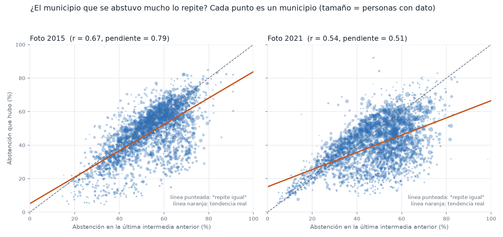
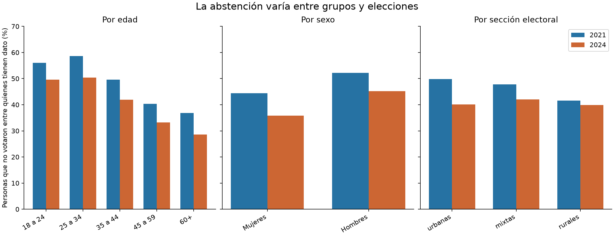
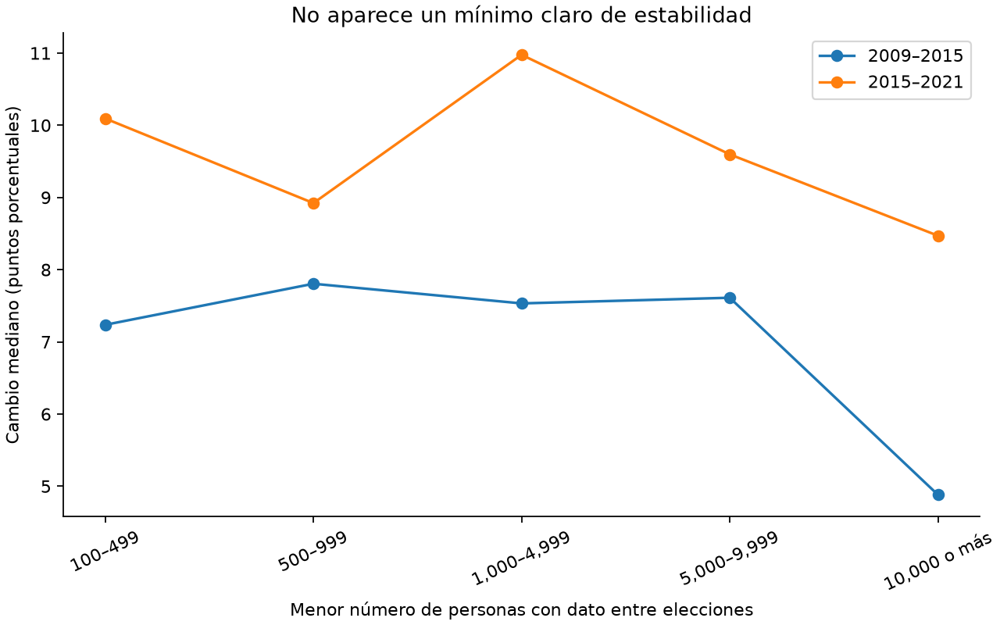
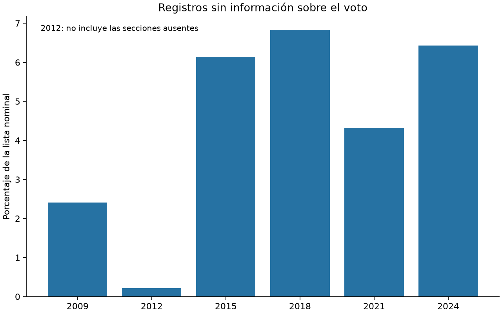
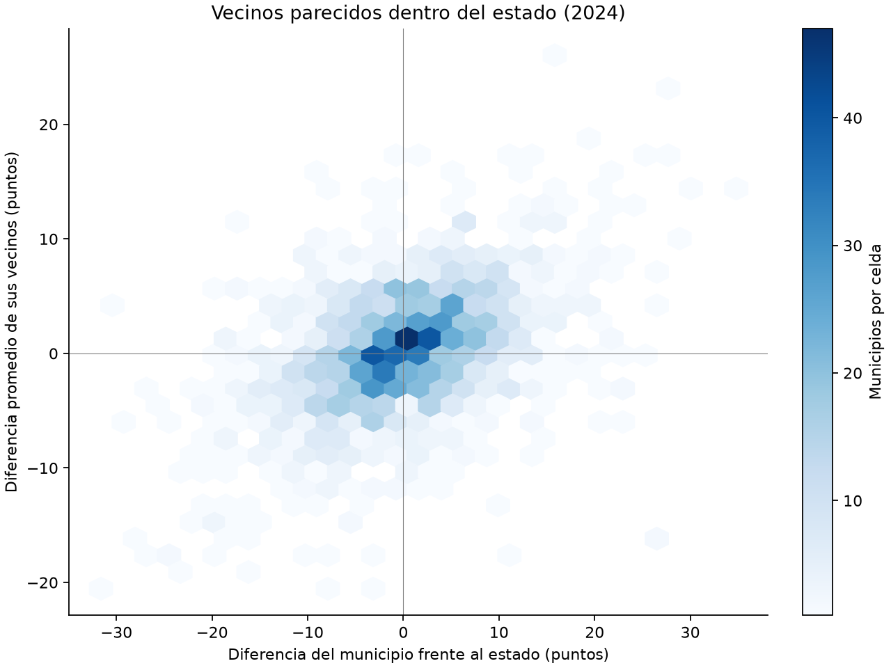

# Reporte del análisis exploratorio (Fase 4)

Aquí van las respuestas a las preguntas de la Fase 4 del plan. Cada una dice **qué encontramos**, **la cifra** y **qué decisión apoya**. Las decisiones son propuestas para la Fase 5. Este reporte se genera con `python scripts/ejecutar_eda.py`.

**Estado:** Respondidas las preguntas 1 a 10.

**Cómo leerlo:** un punto es la diferencia entre dos porcentajes (de 40% a 45% son 5 puntos). Error es cuántos puntos se equivoca, en promedio, una predicción contra lo que de verdad pasó. Los porcentajes de abstención excluyen a quienes no tienen registro de si votaron.

Salvo donde se indica un cálculo nacional por personas o una ponderación, cada municipio tiene el mismo peso.

## Resumen

| # | Respuesta en una línea | Decisión que apoya |
| --- | --- | --- |
| 1 | La abstención municipal tiende a repetirse, pero el historial por sí solo tiene un error importante. | El modelo debe superar la referencia de repetir la última elección del mismo tipo. |
| 2 | La abstención suele ser mayor en intermedias que en presidenciales; la diferencia varía por estado. | Considerar el tipo de elección, el historial presidencial y un mapa de brecha. |
| 3 | El cambio nacional explica poco del error municipal y muchos municipios cambian de color. | Evaluar un semáforo por orden y acompañar la predicción de un rango; decide la Fase 5. |
| 4 | Las personas de 25 a 34 años destacan por su abstención; los hombres superan a las mujeres. | Priorizar el análisis por grupo sin asumir el efecto de una intervención. |
| 5 | Las características de la lista tienen relaciones débiles con la abstención; algunas aportan información repetida. | Evaluar las variables entre elecciones y evitar duplicar información. |
| 6 | No aparece un mínimo de personas con dato que garantice estabilidad. | Comparar distintos mínimos y medir cuántos municipios y personas se excluirían. |
| 7 | La información faltante varía entre municipios, estados y elecciones. | Acompañar la abstención con su cobertura y evaluar distintos límites de NS. |
| 8 | Las secciones ausentes en 2012 afectan de forma desigual a los municipios. | Identificar los municipios afectados y evaluar un historial alternativo sin 2012. |
| 9 | Los municipios con historial reconstruido presentan mayor error de referencia, pero son pocos casos. | Evaluarlos por separado y excluir del entrenamiento las filas sin respuesta. |
| 10 | Los vecinos tienen tasas parecidas, incluso después de descontar el promedio estatal. | Evaluar el modelo separando estados o bloques geográficos completos. |

## Pregunta 1. ¿Quien se abstuvo mucho en una intermedia lo repite en la siguiente?

**Respuesta:** en parte. Es la base de la predicción, pero se equivoca bastante.

| Foto | Municipios comparados | Correlación | Error de repetir (puntos) | Error ponderado (puntos) |
| --- | --- | --- | --- | --- |
| 2015 | 2421 | 0.67 | 9.50 | 5.83 |
| 2021 | 2458 | 0.54 | 12.40 | 8.46 |

Los municipios con mucha abstención tienden a repetirla, pero la relación es moderada y se debilitó entre las dos comparaciones. Los CSV incluyen la comparación sin historial rearmado o incompleto y con al menos 500 personas con dato en la elección previa.

Cuartiles de abstención previa: Q1 es el cuarto de municipios con menor abstención y Q4 el de mayor abstención.

| foto | cuartil | Municipios | antes_pct | despues_pct | sigue_en_cuartil_pct |
| --- | --- | --- | --- | --- | --- |
| 2015 | 1 | 606 | 35.45 | 31.35 | 66.01 |
| 2015 | 2 | 605 | 49.71 | 46.74 | 39.67 |
| 2015 | 3 | 605 | 58.91 | 53.03 | 36.86 |
| 2015 | 4 | 605 | 69.01 | 57.10 | 53.39 |
| 2021 | 1 | 615 | 26.08 | 28.53 | 47.15 |
| 2021 | 2 | 614 | 43.12 | 39.35 | 18.08 |
| 2021 | 3 | 614 | 53.85 | 41.66 | 26.71 |
| 2021 | 4 | 615 | 65.26 | 47.88 | 46.67 |

**Cuidado:** solo hay dos fotos de intermedias, así que no sabemos si el debilitamiento es tendencia o casualidad.

**Decisión que apoya:** la Fase 7 tiene que ganarle al error de repetir la última intermedia en la foto de 2021.



Detalle: `p1_persistencia.csv`, `p1_sin_reconstruccion.csv`, `p1_minimo_500.csv` y `p1_cuartiles.csv`.

Código: `ai/src/eda/eda_p1.py`.

## Pregunta 2. ¿Cuánto más se abstienen en intermedias que en presidenciales? ¿Pasa igual en todos lados?

**Respuesta:** mucho más, pero depende del estado. Casi nunca ocurre al revés.

Brecha entre municipios, en puntos porcentuales:

| eleccion_objetivo | Municipios | mediana_pp | p10_pp | Percentil 90 de la brecha (puntos) |
| --- | --- | --- | --- | --- |
| 2015 | 2447 | 17.32 | 6.30 | 28.47 |
| 2018 | 2454 | 14.63 | 3.23 | 25.12 |
| 2021 | 2468 | 15.65 | 3.35 | 27.56 |
| 2024 | 2477 | 12.08 | 3.51 | 20.44 |

El archivo `p2_brecha_estatal.csv` muestra las diferencias por estado y elección. La salida de terminal conserva también las comparaciones por zona y tamaño.

La historia presidencial ayuda en el ajuste exploratorio. Es un ajuste rápido sobre los mismos datos, no la prueba del modelo:

| foto | Municipios | r2_intermedia | r2_con_presidencial |
| --- | --- | --- | --- |
| 2015 | 2417 | 0.45 | 0.51 |
| 2021 | 2458 | 0.29 | 0.67 |

La brecha comparte cálculo con la última intermedia, así que conviene incluir también por separado las columnas presidenciales (`abst_ultima_presidencial`, `abst_prom_presidenciales`).

**Cuidado:** en la foto 2015 la brecha usa una sola elección de cada tipo (2009 y 2012), y 2012 tiene huecos, así que es más ruidosa.

**Decisión que apoya:** considerar `tipo_objetivo`, conservar el historial presidencial y preparar el mapa de brecha.

Detalle: `p2_brecha.csv`, `p2_brecha_estatal.csv` y `p2_ajuste_exploratorio.csv`.

Código: `ai/src/eda/eda_p2.py`.

## Pregunta 3. ¿Cuánto se mueve el país entre intermedias? ¿Semáforo por nivel o por orden?

**Respuesta:** el país se mueve entre 3 y 5 puntos entre intermedias, pero eso explica poco del error municipal. Con los dos esquemas estudiados, una parte importante de los municipios cambia de color.

**Abstención nacional** (suma de todos los municipios):

| Elección | Abstención (%) |
| --- | --- |
| 2009 | 55.94 |
| 2012 | 37.92 |
| 2015 | 52.93 |
| 2018 | 37.63 |
| 2021 | 48.16 |
| 2024 | 40.33 |

Las intermedias tienen solo dos cambios observados; no alcanzan para proyectar 2027.

Error de repetir la última intermedia, comparado con repetir la diferencia contra el nivel nacional ya observado:

| foto | n | MAE_nivel | MAE_dif_con_pais_real |
| --- | --- | --- | --- |
| 2015 | 2421 | 9.50 | 8.66 |
| 2021 | 2421 | 12.37 | 11.86 |

Qué pasa con un semáforo de tres colores:

| foto | cambia_color_nivel_fijo | cambia_color_por_orden | rojos_nivel_fijo | rojo_previo_sigue_rojo_orden |
| --- | --- | --- | --- | --- |
| 2015 | 40.11 | 39.86 | 18.84 | 60.10 |
| 2021 | 50.35 | 54.98 | 14.91 | 51.92 |

Por nivel, los rojos se encogen cuando el país mejora. Por orden (terciles), el rojo siempre es aproximadamente un tercio y se mantiene más, pero también cambia de color una parte importante de los municipios.

**Decisión que apoya (propuesta; decide el equipo en la Fase 5):** cortar por orden, con terciles de la predicción 2027. Hay que decir en el reporte que el color es relativo al resto del país. El rango de la predicción importa tanto como el número.

Se excluyen de la comparación de 2021 los 30 municipios sin dato de 2015, cuya última intermedia es 2009. Detalle: `p3_abstencion_nacional.csv`, `p3_error_nivel_nacional.csv` y `p3_semaforo.csv`.

Código: `ai/src/eda/eda_p3.py`.

## Pregunta 4. ¿Qué grupos se abstienen más?

**Respuesta:** las personas de 25 a 34 años tienen la mayor abstención nacional entre las edades analizadas en cinco de las seis elecciones; en 2018 las superan las de 18 a 24. En 2021 alcanzan 58.6% y en 2024 50.4%. Los hombres superan a las mujeres en 7.9 puntos en 2021 y 9.4 en 2024. La diferencia entre zonas urbanas y rurales cambia de tamaño según la elección.

Porcentaje de personas con registro conocido que no votaron, sumando primero personas en todo el país:

| Grupo | 2009 | 2012 | 2015 | 2018 | 2021 | 2024 |
| --- | --- | --- | --- | --- | --- | --- |
| 18 a 24 años | 62.84 | 44.30 | 61.92 | 45.24 | 56.04 | 49.60 |
| 25 a 34 años | 63.93 | 46.42 | 62.54 | 44.66 | 58.61 | 50.43 |
| 35 a 44 años | 55.70 | 36.26 | 51.96 | 36.52 | 49.58 | 41.92 |
| 45 a 59 años | 46.86 | 29.05 | 44.52 | 30.62 | 40.31 | 33.26 |
| 60 años o más | 47.79 | 31.24 | 41.82 | 31.56 | 36.82 | 28.58 |
| Mujeres | 52.65 | 33.92 | 49.11 | 33.72 | 44.38 | 35.80 |
| Hombres | 59.47 | 42.22 | 57.05 | 41.86 | 52.24 | 45.24 |
| Secciones urbanas | 57.15 | 38.34 | 55.09 | 38.02 | 49.88 | 40.12 |
| Secciones mixtas | 55.37 | 38.65 | 51.58 | 38.61 | 47.80 | 42.06 |
| Secciones rurales | 51.91 | 35.82 | 45.50 | 35.32 | 41.60 | 39.89 |
| No binario | — | — | — | — | — | 22.55 |



Los grupos de edad, sexo y zona se analizan por separado: se superponen y sus efectos no se pueden sumar. La clasificación urbana/rural corresponde a la sección electoral, no a una característica individual. El grupo no binario solo está registrado en 2024; su tamaño se conserva en el CSV para no equipararlo a grupos grandes.

**Decisión que apoya:** priorizar el análisis de los grupos con mayor abstención y mayor número de personas. Estos datos describen a quiénes no votaron; no demuestran que una campaña dirigida a un grupo vaya a tener más efecto.

Detalle: `p4_grupos_nacional.csv`, `p4_grupos_municipios.csv` y `p4_comparaciones_dentro_municipio.csv`. El último compara grupos dentro de un mismo municipio.

Código: `ai/src/eda/eda_p4.py`.

## Pregunta 5. ¿Qué características se relacionan con más abstención?

**Respuesta:** las relaciones por separado son débiles y algunas cambian de signo entre elecciones. La proporción de mujeres se relaciona positivamente con la abstención municipal (0.13 a 0.32), aunque las mujeres votan más que los hombres cuando se comparan las tasas por sexo. Son comparaciones distintas: un municipio con más mujeres no equivale a medir el comportamiento de una mujer individual. La relación de la proporción rural con la abstención municipal es negativa (−0.22 a −0.05). Edad promedio y proporción de mayores tienen una correlación cercana a 0.98 entre sí.

Se compara la composición de la lista de la elección anterior con la abstención posterior. Cada municipio tiene el mismo peso y cada elección se analiza por separado, para no mezclar presidenciales con intermedias.

Relación entre el orden de los municipios según cada característica y según su abstención (Spearman, de −1 a 1; positivo: ambos tienden a subir juntos; negativo: uno sube mientras el otro baja):

| Característica previa | 2015 | 2018 | 2021 | 2024 |
| --- | --- | --- | --- | --- |
| Edad promedio | -0.04 | 0.08 | 0.05 | 0.07 |
| Personas registradas | 0.02 | 0.16 | 0.18 | 0.09 |
| Número de distritos federales | 0.12 | 0.09 | 0.16 | 0.06 |
| % de 18 a 24 años | -0.08 | -0.14 | -0.10 | -0.09 |
| % de 25 a 34 años | 0.05 | -0.07 | -0.04 | -0.000 |
| % de 35 a 44 años | 0.16 | -0.02 | -0.02 | -0.13 |
| % de 45 a 59 años | 0.03 | 0.08 | 0.09 | -0.007 |
| % de 60 años o más | -0.09 | 0.06 | 0.02 | 0.08 |
| % en secciones mixtas | -0.03 | -0.07 | -0.07 | -0.03 |
| % de mujeres | 0.32 | 0.14 | 0.24 | 0.13 |
| % en secciones rurales | -0.22 | -0.13 | -0.19 | -0.05 |
| % en secciones urbanas | 0.15 | 0.16 | 0.17 | 0.05 |

El archivo `p5_asociaciones.csv` también resta los promedios estatales a los órdenes para comprobar cuánto cambia la relación al comparar municipios dentro de estados. Es un diagnóstico descriptivo, sin entrenar modelos.

**Decisión que apoya:** llevar las variables a la selección de la Fase 5 según su consistencia entre elecciones, sin convertir una asociación en una explicación causal ni en una garantía de capacidad predictiva. Edad promedio y proporción de mayores pueden aportar información repetida; los porcentajes de las cinco edades suman uno, al igual que urbana/mixta/rural, por lo que un futuro modelo lineal con intercepto necesitaría omitir una categoría por conjunto. El número de distritos no se interpreta como causa de abstención.

Detalle: `p5_asociaciones.csv` y `p5_variables_parecidas.csv`. No se usa la composición de la propia elección objetivo.

Código: `ai/src/eda/eda_p5.py`.

## Pregunta 6. ¿Desde cuántas personas con dato se estabiliza el porcentaje?

**Respuesta:** no se observa un tamaño a partir del cual los cambios desaparezcan. En 2015–2021, el cambio mediano es 10.1 puntos para municipios con 100–499 personas con dato, 8.9 para 500–999 y 8.5 para 10,000 o más. El patrón no es una reducción continua con el tamaño.

Se comparan elecciones consecutivas del mismo tipo, sin cambios territoriales detectados durante el intervalo y con un máximo de 10% de registros sin información en ambas. El tamaño es el menor número de personas con dato entre las dos elecciones. Ejemplo de intermedias 2015–2021:

| Periodo | Personas con dato | Municipios | Cambio central (puntos) | Cambio promedio (puntos) | 90% cambia menos de (puntos) |
| --- | --- | --- | --- | --- | --- |
| 2015–2021 | 1–99 | 1 | 67.06 | 67.06 | 67.06 |
| 2015–2021 | 100–499 | 59 | 10.09 | 10.87 | 20.31 |
| 2015–2021 | 500–999 | 100 | 8.92 | 12.15 | 26.11 |
| 2015–2021 | 1,000–4,999 | 467 | 10.98 | 14.67 | 32.78 |
| 2015–2021 | 5,000–9,999 | 304 | 9.60 | 14.09 | 31.41 |
| 2015–2021 | 10,000 o más | 868 | 8.47 | 10.72 | 23.19 |

**No existe un mínimo universal que estos datos permitan certificar.** Los cambios observados también incluyen cambios reales de participación, composición y cobertura. No son errores de una muestra aleatoria: el CCPC cuenta registros censales disponibles. Un municipio pequeño puede tener una tasa exacta para sus registros conocidos y aun así una tasa poco estable en el tiempo.

Costo de aplicar distintos mínimos en 2024 (solo municipios con alguna información):

| Mínimo de personas | Municipios excluidos | Personas excluidas | % de personas con dato |
| --- | --- | --- | --- |
| 100 | 2 | 166 | 0.000 |
| 500 | 70 | 23650 | 0.03 |
| 1000 | 176 | 101450 | 0.11 |
| 5000 | 830 | 1918865 | 2.09 |

**Decisión que apoya:** evaluar 100, 500 y 1,000 personas como reglas de sensibilidad en la Fase 5, sin declarar automáticamente confiables a los municipios que superen un corte. Mantener visibles los casos pequeños y su cobertura. La Fase 7 deberá comparar el error y la cobertura de esas reglas.

Detalle: `p6_estabilidad_por_tamano.csv`, `p6_pares_comparables.csv` y `p6_cobertura_segun_minimo.csv`.



Código: `ai/src/eda/eda_p6.py`.

## Pregunta 7. ¿Dónde y cuándo falta información sobre si las personas votaron?

**Respuesta:** la información faltante nacional va de 0.22% en 2012 a 6.83% en 2018, pero el bajo valor de 2012 no incluye las secciones ausentes. El mayor porcentaje estatal observado es 18.55% en Quintana Roo en 2015. En 2024 hay 488 municipios con más de 10% sin información y 38 con más de la mitad.

NS cuenta personas para las que no se sabe si votaron. Su porcentaje se calcula sobre toda la lista nominal; la abstención publicada se calcula solo entre quienes sí tienen esa información.

| Elección | Sin información (%) | Abstención conocida (%) | Extremo menor (%) | Extremo mayor (%) |
| --- | --- | --- | --- | --- |
| 2009 | 2.41 | 55.94 | 54.59 | 57.00 |
| 2012 | 0.22 | 37.92 | 37.83 | 38.05 |
| 2015 | 6.13 | 52.93 | 49.68 | 55.81 |
| 2018 | 6.83 | 37.63 | 35.06 | 41.90 |
| 2021 | 4.32 | 48.16 | 46.08 | 50.40 |
| 2024 | 6.43 | 40.33 | 37.74 | 44.17 |

Los extremos posibles asignan todos los NS a quienes votaron o a quienes no votaron. No son intervalos de confianza ni predicciones; muestran cuánto desconocimiento deja la información faltante.

Diez combinaciones estado–elección con mayor proporción sin información:

| Elección | Estado | Sin información (%) |
| --- | --- | --- |
| 2015 | QUINTANA ROO | 18.55 |
| 2015 | BAJA CALIFORNIA SUR | 18.12 |
| 2015 | GUERRERO | 17.52 |
| 2018 | SINALOA | 16.89 |
| 2015 | OAXACA | 15.92 |
| 2024 | CHIHUAHUA | 14.92 |
| 2024 | CAMPECHE | 14.86 |
| 2015 | TABASCO | 14.83 |
| 2015 | SONORA | 14.81 |
| 2024 | COAHUILA | 14.50 |

| Elección | Sin dato | NS mayor de 10% | NS mayor de 20% | NS mayor de 50% |
| --- | --- | --- | --- | --- |
| 2009 | 7 | 115 | 43 | 16 |
| 2012 | 1 | 24 | 8 | 3 |
| 2015 | 30 | 410 | 199 | 67 |
| 2018 | 13 | 532 | 231 | 56 |
| 2021 | 10 | 322 | 132 | 26 |
| 2024 | 12 | 488 | 210 | 38 |

**Decisión que apoya:** conservar la definición de abstención sobre casos conocidos y acompañarla de la cobertura. Comparar resultados con máximos de 10% y 20% de NS, sin tratarlos como límites oficiales. No asumir que los registros faltantes se comportan como los conocidos. Ausencias de secciones completas en 2012 no están incluidas en el NS de las secciones presentes (pregunta 8).

Detalle: archivos `p7_*.csv`.



Código: `ai/src/eda/eda_p7.py`.

## Pregunta 8. ¿Cuánto afecta la información ausente de 2012?

**Respuesta:** el problema está concentrado territorialmente. En 2012, limitar el cálculo a las secciones presentes también en 2009 y 2015 cambia la abstención nacional de 37.92% a 37.73% (0.19 puntos), pero esta diferencia no recupera la abstención de las secciones ausentes. Los municipios con más de 10% de hueco tienen un error de referencia de 7.56 puntos en 2018, frente a 5.86 en los que no tienen hueco; es una asociación, no una estimación del daño causado por la ausencia.

Faltan **1,048 secciones** presentes en 2009 y 2015. El catálogo identifica **332 municipios afectados**, de los que **66** tienen más de 10% de su lista de 2009 en esas secciones. No son registros NS: las secciones enteras no aparecen en el archivo de 2012.

| Elección | Secciones consideradas | Secciones | Personas registradas | Abstención (%) |
| --- | --- | --- | --- | --- |
| 2009 | Todas las disponibles | 64934 | 77481831 | 55.94 |
| 2009 | Presentes en los tres años | 63568 | 75332733 | 55.78 |
| 2009 | Ausentes en 2012 | 1048 | 626254 | 58.46 |
| 2012 | Todas las disponibles | 65599 | 76490962 | 37.92 |
| 2012 | Presentes en los tres años | 63568 | 74482294 | 37.73 |
| 2012 | Ausentes en 2012 | 0 | 0 | — |
| 2015 | Todas las disponibles | 68362 | 83563462 | 52.93 |
| 2015 | Presentes en los tres años | 63568 | 80221352 | 52.68 |
| 2015 | Ausentes en 2012 | 1048 | 604240 | 51.72 |

Comparar las mismas secciones en los tres años separa parte del cambio de cobertura del cambio entre elecciones. Las tasas de 2009 y 2015 de las secciones ausentes describen esos otros años; no permiten saber cuánto se abstuvieron sus habitantes en 2012.

Error de repetir la última presidencial, por proporción del hueco histórico:

| Elección | Parte ausente de 2012 | Municipios | Error promedio (puntos) |
| --- | --- | --- | --- |
| 2018 | Sin hueco | 2113 | 5.86 |
| 2018 | Hasta 10% | 265 | 4.48 |
| 2018 | Más de 10% | 63 | 7.56 |
| 2024 | Sin hueco | 2114 | 5.80 |
| 2024 | Hasta 10% | 266 | 4.70 |
| 2024 | Más de 10% | 66 | 6.19 |

En 2018 la última presidencial es 2012 cuando tiene dato. En 2024 suele ser 2018; esta segunda comparación sirve como contraste descriptivo, no como medición del efecto causal de 2012.

**Decisión que apoya:** conservar 2012 identificado como incompleto y evaluar un historial alternativo sin 2012 en la Fase 7. No excluirlo de todos los municipios ni rellenar automáticamente el hueco. Deben revisarse individualmente los municipios ausentes por completo y los más afectados.

Detalle: archivos `p8_*.csv`; el porcentaje de hueco del catálogo está en escala 0–100.

Código: `ai/src/eda/eda_p8.py`.

## Pregunta 9. ¿Se comportan distinto los municipios sin información o con historial reconstruido?

**Respuesta:** los municipios reconstruidos presentan un mayor error de referencia en los dos años donde aparecen. En 2021 es de 14.66 puntos con reconstrucción completa y 19.45 con reconstrucción incompleta, frente a 12.37 sin reconstrucción. En 2024 las diferencias son menores: 6.31, 7.14 y 5.69. Los tamaños de los grupos son pequeños; no basta para justificar una exclusión general.

Hay **73 registros municipio–elección sin respuesta conocida** en la tabla de análisis. Su abstención está vacía y no debe interpretarse como cero. No se puede comparar su abstención con la de los demás porque precisamente se desconoce.

El historial reconstruido recalcula el pasado con las secciones del territorio que se analiza. Se separa el que pudo reconstruirse completo del que dejó secciones sin asignar. Las categorías siguientes no se superponen; se evalúa el error de repetir la última elección del mismo tipo:

| Elección | Grupo | Municipios | Sin respuesta | Comparables | Error promedio (puntos) |
| --- | --- | --- | --- | --- | --- |
| 2015 | Sin reconstrucción | 2458 | 30 | 2421 | 9.50 |
| 2018 | Sin reconstrucción | 2463 | 13 | 2441 | 5.75 |
| 2021 | Reconstruido completo | 17 | 1 | 16 | 14.66 |
| 2021 | Reconstruido incompleto | 6 | 1 | 5 | 19.45 |
| 2021 | Sin reconstrucción | 2445 | 8 | 2437 | 12.37 |
| 2024 | Reconstruido completo | 35 | 0 | 35 | 6.31 |
| 2024 | Reconstruido incompleto | 11 | 0 | 11 | 7.14 |
| 2024 | Sin reconstrucción | 2431 | 12 | 2419 | 5.69 |

**Decisión que apoya:** excluir del entrenamiento las filas sin respuesta, conservándolas en la cobertura. Los municipios reconstruidos requieren una evaluación separada antes de descartarlos. Las diferencias observadas no aíslan el efecto de reconstruir: también cambian los estados, tamaños y condiciones de los municipios. Los grupos reconstruidos tienen pocos casos; evitar conclusiones generales.

Detalle: `p9_municipios_sin_respuesta.csv` y `p9_historial_y_error.csv`.

Código: `ai/src/eda/eda_p9.py`.

## Pregunta 10. ¿Los municipios vecinos se parecen?

**Respuesta:** sí, en el conjunto comparable de 1,740 municipios. La relación con el promedio de sus vecinos es 0.69 en 2021 y 0.70 en 2024; al descontar el promedio estatal permanece en 0.47 y 0.45. La similitud no se explica únicamente por pertenecer al mismo estado.

Se descargó el mapa municipal de diciembre de 2022 de INEGI, publicado por CONABIO. Se unieron **2,475 de 2,477 municipios** por estado y nombre normalizado, con diez variantes de nombre explícitas y verificables. Eldorado y Juan José Ríos no tienen polígono propio en ese mapa. No se unieron directamente los números municipales del INE y del INEGI.

Dos municipios se consideran vecinos si sus polígonos comparten borde o punto. Se repararon 0 geometrías inválidas antes de buscar esos contactos. Se usa el mismo conjunto de municipios en 2021 y 2024, con al menos 90% de cobertura en ambos años y sin historial marcado como reconstruido en 2024. Esta restricción reduce discrepancias entre el mapa de 2022 y los territorios electorales; no demuestra equivalencia cartográfica histórica exacta.

| Elección | Comparación | Municipios | Contactos dirigidos | Relación con vecinos | Índice de Moran | Probabilidad al reordenar |
| --- | --- | --- | --- | --- | --- | --- |
| 2021 | Nacional | 1740 | 8178 | 0.69 | 0.52 | 0.001 |
| 2021 | Dentro del estado | 1740 | 8178 | 0.47 | 0.31 | 0.001 |
| 2024 | Nacional | 1740 | 8178 | 0.70 | 0.54 | 0.001 |
| 2024 | Dentro del estado | 1740 | 8178 | 0.45 | 0.29 | 0.001 |

De los 1,765 municipios que pasan los filtros de cobertura y territorio, 25 no tienen vecino que también los pase; se excluyen de este cálculo. Son resultados del conjunto seleccionado, no de todos los municipios del país.

El índice de Moran resume si municipios vecinos tienen valores parecidos: un valor positivo indica agrupación de valores altos con altos y bajos con bajos. Se compara con 999 reordenamientos al azar (semilla fija 20261025). En la comparación dentro del estado se resta el promedio estatal y los valores se reordenan únicamente dentro de cada estado. La probabilidad mostrada es unilateral para similitud positiva; no mide el tamaño de la relación ni demuestra una influencia causal entre vecinos.

**Decisión que apoya:** además de separar elecciones en el tiempo, evaluar el futuro modelo dejando estados o bloques geográficos completos fuera del entrenamiento. Una división municipal aleatoria puede dar resultados demasiado favorables si mezcla zonas muy relacionadas. Usar también un margen de separación espacial si se busca evaluar territorios sin vecinos conocidos. No se entrenó ningún modelo ni se añadieron polígonos como predictores.

Fuente: [metadatos CONABIO](http://geoportal.conabio.gob.mx/metadatos/doc/html/mun22gw.html). El ZIP y su SHA256 se conservan en `data/external/cartografia/mun22gw/fuente.json`. Detalle: archivos `p10_*.csv`; la equivalencia es para este EDA y no sustituye la revisión cartográfica final de la Fase 6.



Código: `ai/src/eda/eda_p10.py`.

## Cómo repetirlo

Desde la raíz del repositorio, con el entorno activado:

```bash
python scripts/ejecutar_eda.py
```

El ejecutor comprueba o descarga la cartografía y corre las diez preguntas en paralelo. Solo publica este reporte si todos los procesos terminan correctamente. Para ejecutar una pregunta individual y actualizar su sección:

```bash
python ai/src/eda/eda_p4.py
python ai/src/eda/eda_p10.py
```

Tablas, salidas de terminal y manifiestos de fuentes: `docs/EDA/resultados/`. Las figuras están en `docs/EDA/`. Cada sección indica el script que la genera. La pregunta 4 requiere los seis archivos de la Fase 1 y la 8 requiere `data/interim/secciones.parquet`. La cartografía se obtiene con `python scripts/descargar_cartografia_eda.py`. No se modifican las tablas canónicas de `data/processed/`.
